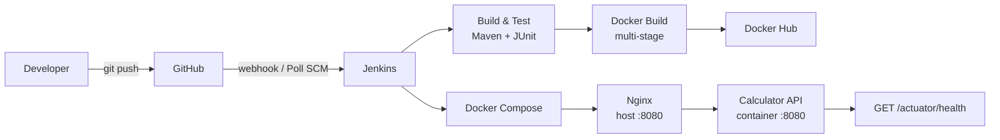

# Calculator REST API — CI/CD Mini Project

A small production-style Calculator REST API built with **Spring Boot 4**, **Maven**, and **Java 21**, wrapped in an automated CI/CD pipeline using **Jenkins**, **Docker**, and **Docker Compose** with an **Nginx** reverse proxy.

- GitHub repository: <https://github.com/IbrahimMI124/RESTCalculator>
- Docker Hub image: <https://hub.docker.com/r/ibrahimmi124/calculator-service>

## Architecture



## Tech stack

| Area | Technology |
|---|---|
| Application | Java 21, Spring Boot 4, Spring Web, Spring Actuator |
| Build | Maven (wrapper included) |
| Tests | JUnit 5, Spring MockMvc |
| CI/CD | Jenkins declarative pipeline |
| Containers | Docker multi-stage build, non-root runtime |
| Deployment | Docker Compose, Nginx reverse proxy |

## Repository layout

```text
calculator/
├── src/main/java/com/example/calculator/   # Application source
├── src/test/java/com/example/calculator/   # Unit + integration tests
├── src/main/resources/application.properties
├── nginx/default.conf                      # Nginx reverse proxy config
├── Dockerfile                              # Multi-stage image build
├── docker-compose.yml                      # App + Nginx stack
├── Jenkinsfile                             # Declarative CI/CD pipeline
├── .dockerignore
├── .gitignore
├── .env.example                            # Local Compose variables
├── pom.xml
└── README.md
```

## Prerequisites

- JDK 21
- Maven 3.9+ (or use `./mvnw`)
- Docker Engine + Docker Compose v2
- Jenkins with the JDK 21 and Maven tools configured (for the pipeline)

## Build and test

```bash
# Compile and package the executable JAR
./mvnw clean package

# Run the tests only
./mvnw test
```

Tests are split into:

- `CalculatorServiceTest` — unit tests for add, subtract, multiply, divide, and divide-by-zero.
- `CalculatorControllerIntegrationTest` — MockMvc tests for all operations, validation failures, division by zero, and the health endpoint.
- `CalculatorApplicationTests` — Spring context load test.

Surefire writes JUnit XML reports to `target/surefire-reports/`, which the Jenkins `Test` stage publishes.

## Run locally

```bash
./mvnw spring-boot:run
```

The API starts on <http://localhost:8080>. Stop the Compose stack first if it is already using that port, or change `server.port`.

## API

| Operation | Endpoint | Example |
|---|---|---|
| Add | `GET /api/v1/add?a=&b=` | `/api/v1/add?a=2&b=3` |
| Subtract | `GET /api/v1/subtract?a=&b=` | `/api/v1/subtract?a=8&b=3` |
| Multiply | `GET /api/v1/multiply?a=&b=` | `/api/v1/multiply?a=4&b=3` |
| Divide | `GET /api/v1/divide?a=&b=` | `/api/v1/divide?a=10&b=2` |
| Health | `GET /actuator/health` | `/actuator/health` |

Successful response:

```json
{
  "operation": "add",
  "a": 2.0,
  "b": 3.0,
  "result": 5.0
}
```

Error responses return HTTP `400` with a structured body:

```json
{
  "timestamp": "2026-10-30T09:50:50.794Z",
  "status": 400,
  "error": "Bad Request",
  "message": "Division by zero is not allowed",
  "path": "/api/v1/divide"
}
```

Invalid or missing parameters also return `400` with a descriptive message.

### Quick checks

```bash
curl "http://localhost:8080/api/v1/add?a=2&b=3"
curl "http://localhost:8080/api/v1/subtract?a=8&b=3"
curl "http://localhost:8080/api/v1/multiply?a=4&b=3"
curl "http://localhost:8080/api/v1/divide?a=10&b=2"
curl "http://localhost:8080/api/v1/divide?a=1&b=0"
curl "http://localhost:8080/actuator/health"
```

## Docker

The `Dockerfile` is a two-stage build:

1. **Build stage** — `maven:3.9-eclipse-temurin-21` compiles the JAR after caching dependencies.
2. **Runtime stage** — `eclipse-temurin:21-jre-jammy` copies only the executable JAR, installs `curl` for health checks, and runs as the non-root `app` user.

Build and run the image directly:

```bash
docker build -t calculator-service:local .
docker run --rm -p 8081:8080 calculator-service:local
curl "http://localhost:8081/api/v1/add?a=2&b=3"
```

## Docker Compose

`docker-compose.yml` starts the full stack:

- `calculator` — the Spring Boot API (internal port `8080`)
- `nginx` — reverse proxy published on host port `8080`
- `calculator-network` — bridge network shared by both services
- health checks for both services and `depends_on: condition: service_healthy`

```bash
# Start the stack (builds the image locally if needed)
docker compose up -d --build

# Check status and logs
docker compose ps
docker compose logs -f

# Call the API through Nginx
curl "http://localhost:8080/api/v1/add?a=2&b=3"
curl "http://localhost:8080/actuator/health"

# Stop and remove containers and the network
docker compose down --remove-orphans
```

Local configuration is read from `.env`:

```bash
cp .env.example .env
```

| Variable | Default | Purpose |
|---|---|---|
| `DOCKERHUB_USERNAME` | `local` | Docker Hub account used in the image name |
| `IMAGE_TAG` | `local` | Image tag to run |
| `PROXY_PORT` | `8080` | Host port exposed by Nginx |

## Jenkins pipeline

The declarative `Jenkinsfile` contains these stages:

| Stage | What it does |
|---|---|
| Checkout | Pulls `main` from GitHub |
| Build | `mvn -B clean package -DskipTests` |
| Test | `mvn -B test`, then publishes `target/surefire-reports/*.xml`; the build fails if tests fail |
| Docker Build | Builds and tags the image with `${BUILD_NUMBER}` and `latest` |
| Push | Logs in to Docker Hub with the Jenkins credentials ID `docker-hub-credentials` and pushes both tags |
| Deploy | Pulls the new image, recreates the Compose stack with `docker compose down --remove-orphans` + `up -d --no-build --wait`, then verifies `/actuator/health` through Nginx |

Other pipeline features:

- Declarative pipeline checked into the repository.
- `pollSCM('H/5 * * * *')` trigger. A GitHub webhook can be used instead/preferred; configure the Jenkins job with the repository and enable the GitHub hook trigger.
- Jenkins-managed Docker Hub credentials — no credentials are stored in the repository.
- Email notifications on success and failure via `emailext`.
- `disableConcurrentBuilds`, a 30-minute timeout, timestamped console output, and build rotation.
- Deploy is re-runnable: stale containers and the old Compose network are removed before the new stack starts, so a failed previous run cannot leave services disconnected.

### Jenkins prerequisites

1. Jenkins tools named `JDK21` and `Maven`.
2. A username/password credential with ID `docker-hub-credentials` for Docker Hub.
3. The Email Extension plugin configured with an SMTP server.
4. A pipeline job pointing at this repository (Pipeline script from SCM), with GitHub webhook or Poll SCM enabled.

## Configuration

The application exposes only the Actuator `health` endpoint:

```properties
server.port=8080
management.endpoints.web.exposure.include=health
management.endpoint.health.show-details=never
```

Compose also sets the equivalent `SERVER_PORT` and management environment variables explicitly.

## Troubleshooting

- **Port 8080 is already in use** — stop the other process, or set `PROXY_PORT` (Compose) / `server.port` (app) to another port.
- **A Compose service cannot resolve another service** — the project network is stale; run `docker compose down --remove-orphans` and start the stack again.
- **Jenkins is not starting builds automatically** — confirm the job polls this repository or has a GitHub webhook, and that `pollSCM` is enabled in the pipeline.
- **No JUnit results in Jenkins** — check that `target/surefire-reports/*.xml` exists; the Test stage fails intentionally when no reports are produced.

## Security notes

- The runtime image runs as an unprivileged user (`app`).
- The Nginx config is mounted read-only and exposes only the API.
- Actuator details are hidden; only the health status is public.
- `.gitignore` excludes environment files, keys, and logs; no secrets are committed.
- Docker Hub authentication is handled entirely by Jenkins credentials.
